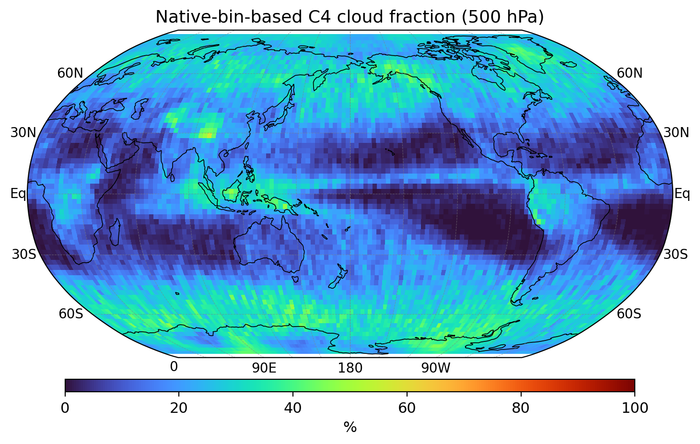
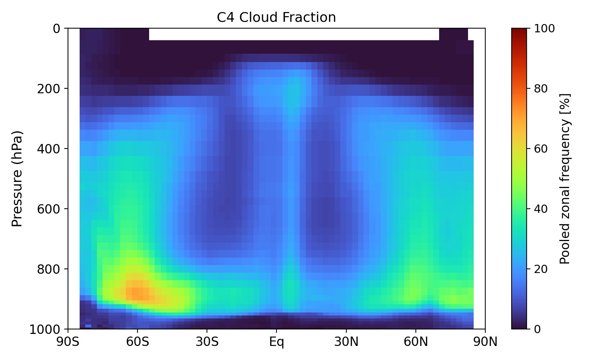
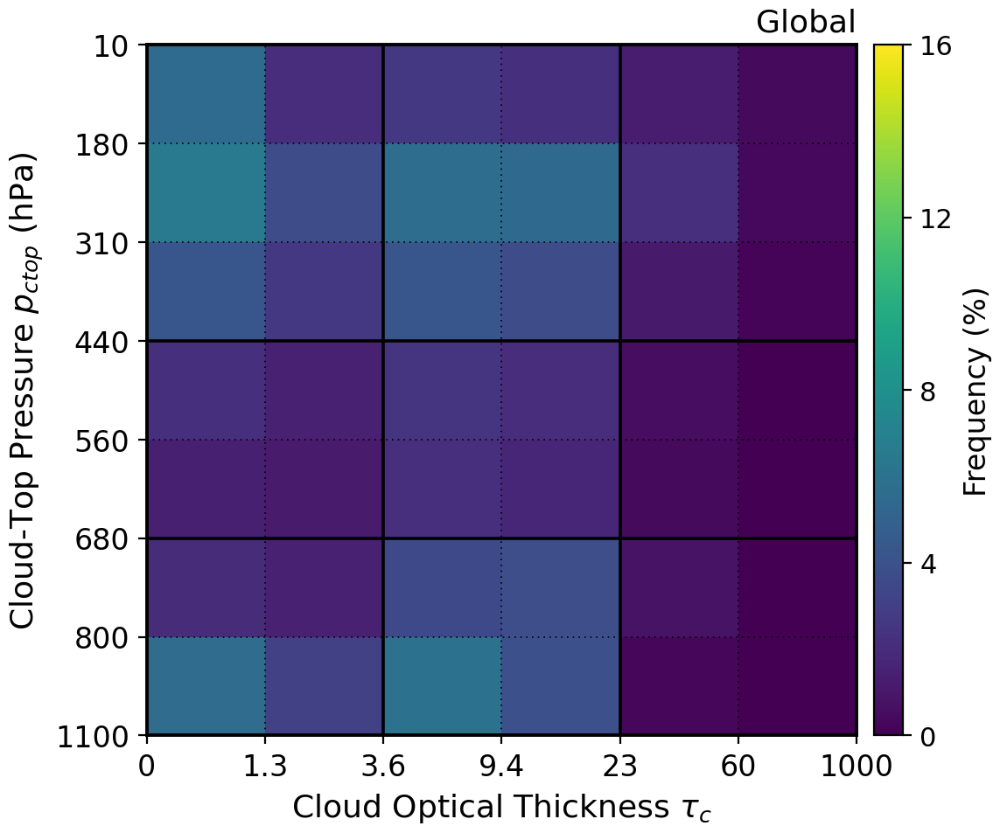
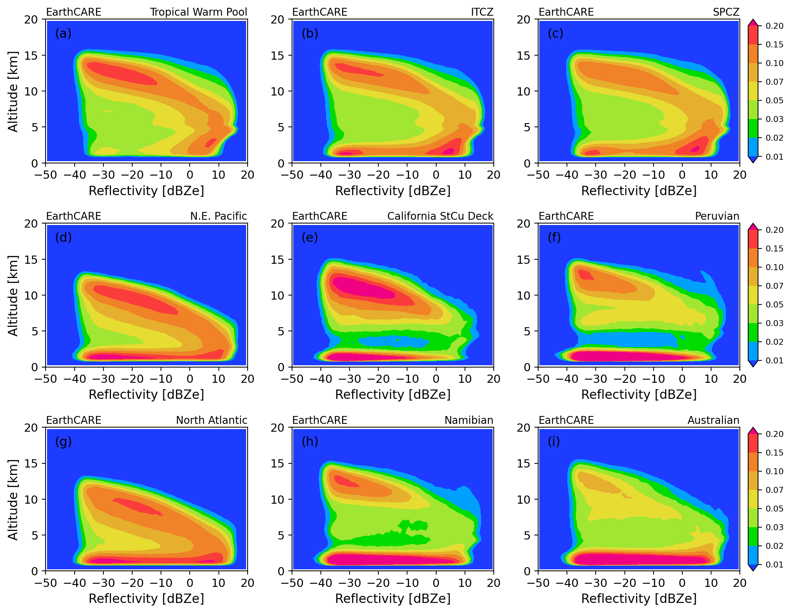
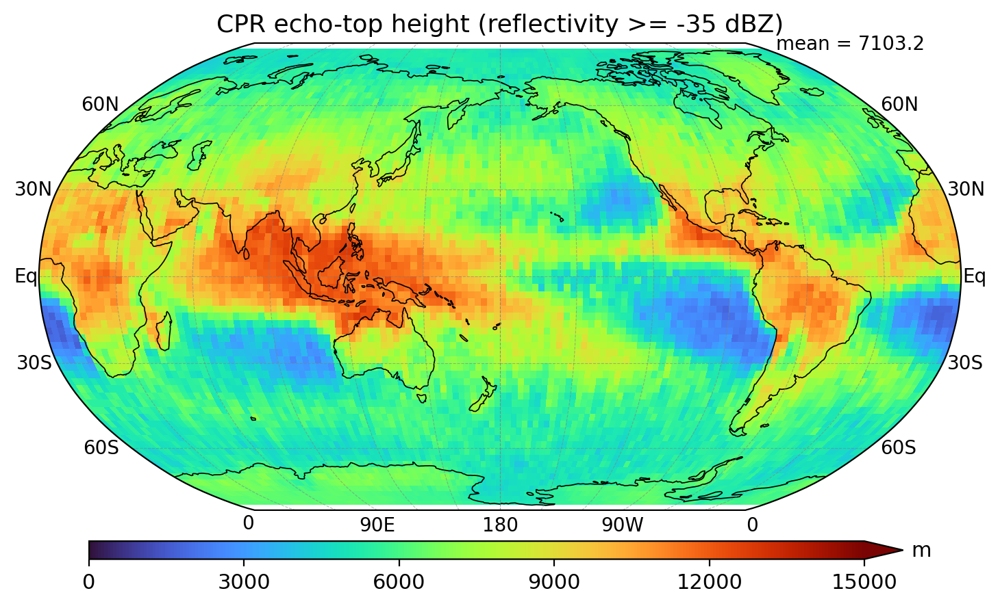
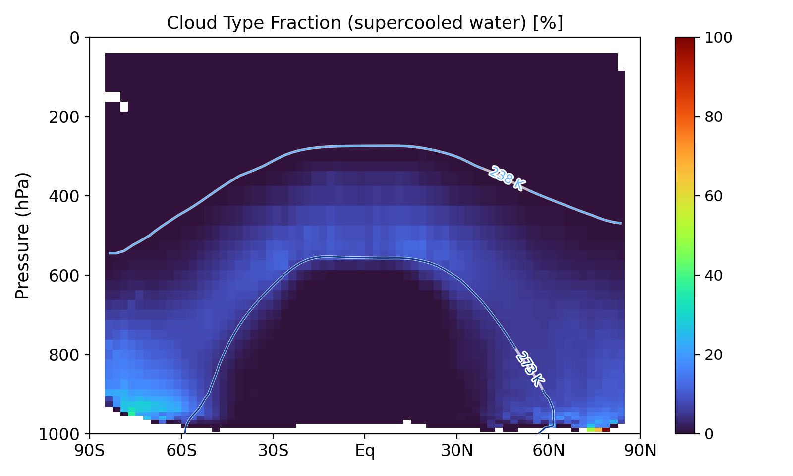

# EarthCARE F90Reader AC_CLP v1.0

EarthCARE F90Reader is a package of Fortran 90 (F90) code for generating monthly and annual mean Level-3 datasets from Level-2 EarthCARE granule files. The output is written in NetCDF-4 format. The package also provides multi-parameter statistics, including CFADs (Contoured Frequency by Altitude Diagrams) and ISCCP-like joint histograms, to support process-oriented model evaluation. Visualization scripts are also included.


## Example Outputs

The following figures illustrate representative Level 3 diagnostics generated from EarthCARE AC_CLP observations for September 2024–August 2025. These examples cover a one-year period and should not be interpreted as a long-term climatology. Click a figure to view it at full resolution.

| | |
| --- | --- |
| **C4 Cloud Fraction**<br>[](docs/figures/c4_cloud_fraction.png)<br>CPR-or-ATLID cloud occurrence at 500 hPa (%). | **C4 Zonal Mean**<br>[](docs/figures/c4_zonalmean.png)<br>Latitude–pressure section from longitude-pooled cloud and valid-bin counts (%). |
| **ISCCP-like Histogram**<br>[](docs/figures/isccp.png)<br>Global COT–C4 cloud-top-pressure frequency (%). | **CFAD**<br>[](docs/figures/cfad.png)<br>Radar reflectivity–altitude frequency (%) in nine regions. |
| **Cloud-Top Height**<br>[](docs/figures/cloud_top_height.png)<br>Mean CPR echo-top height for reflectivity ≥ −35 dBZ (m). | **Cloud Particle Type**<br>[](docs/figures/particle_type.png)<br>Supercooled water (Type 2): longitude-mean fraction among classified CPR cloud bins (%). |


## Required Libraries

- [HDF5 Library](https://www.hdfgroup.org/solutions/hdf5/)
- [NetCDF4 Library](https://downloads.unidata.ucar.edu/netcdf/) (NetCDF-C Ver4.9.2 or later; NetCDF-Fortran Ver4.6.1 or later)


## Package Structure

This repository contains the following directories:
- `src/` contains the F90 routines for reading the original EarthCARE Level-2 data using the HDF5 library.
- `output/` stores generated output and includes example visualization scripts.

Users need to place the EarthCARE data in an appropriate location and set the input directory and processing period before running `src/main.sh` (see the [Test Run](#test-run) guide below for details).


## Test Run

All paths below are relative to this package directory (`EarthCARE_F90Reader_AC_CLP_v1.0/`).

### 1. Configure the compiler and libraries

Edit [`src/Makefile`](src/Makefile) to match your compiler, compiler flags, and HDF5/NetCDF include and library paths. The default compiler is Intel Fortran (`ifort`).

### 2. Set the input, analysis period, and automatic plotting

Edit the `User settings` block at the beginning of [`src/main.sh`](src/main.sh). All routine execution settings are in this block; no `export` or `setenv` commands are required in the terminal. The same procedure works from Bash and tcsh.

```bash
# Replace the placeholder with the root containing YYYY/MM input directories.
DATA_DIR=${DATA_DIR:-"/path/to/2B.AC_CLP.vCb"}

# Inclusive analysis period: September 2024 through August 2025 in this example.
START_YM=${START_YM:-"202409"}
END_YM=${END_YM:-"202508"}

VERSION=${VERSION:-"vCb"}
OVERWRITE_OUTPUT=${OVERWRITE_OUTPUT:-0}
RUN_VISUALIZATION=${RUN_VISUALIZATION:-0}
PYTHON=${PYTHON:-"python3.11"}
```

Change the values after `:-` while preserving the surrounding syntax. For example, change `RUN_VISUALIZATION=${RUN_VISUALIZATION:-0}` to `RUN_VISUALIZATION=${RUN_VISUALIZATION:-1}` to enable automatic plotting.

| Setting in `src/main.sh` | What to set |
| ----------------------- | ----------- |
| `DATA_DIR` | Input root, such as `/path/to/2B.AC_CLP.vCb`. Replace the supplied placeholder. Inputs are searched under `DATA_DIR/YYYY/MM/`, including subdirectories, for files ending in `*<VERSION>.h5`. |
| `START_YM`, `END_YM` | First and last months, both included, in `YYYYMM` format. Supplied defaults: `202409` and `202508`. Use the same value for a single month; year-crossing periods are supported. |
| `VERSION` | Input product version; default `vCb`. This is separate from the reader version (`1.0`). |
| `RUN_VISUALIZATION` | `0`: generate Level-3 NetCDF only (default). `1`: also generate standard All-period PDF figures after successful processing. |
| `PYTHON` | Python command for automatic plotting; default `python3.11`. Used only when `RUN_VISUALIZATION=1`. |
| `OVERWRITE_OUTPUT` | `0`: stop if any expected NetCDF already exists (default). `1`: allow replacement of same-named NetCDF outputs. |

The `${NAME:-value}` syntax retains optional environment overrides: an existing nonempty environment variable of the same name takes precedence over the value edited here. Normally, just edit this block and run the script.

Every selected month must contain matching input files; a missing month directory or a month with no matching files stops the run. Annual outputs contain only the selected months within each calendar year, so a file named `2024` can represent a partial year. All-period outputs contain the entire selected period. Output names do not encode the complete selected period or horizontal resolution; in particular, `*_all.nc` names are reused between runs. Move existing results aside before processing another configuration, or enable replacement intentionally.

### 3. Set the analysis grid and input scan mode, if needed

Edit [`src/parameters.f90`](src/parameters.f90) for these compile-time settings. They are separate from the execution settings in `main.sh`.

| Setting in `src/parameters.f90` | Default | Meaning |
| ----------------------------- | ------- | ------- |
| `reso` | `2.50_sp` | Level-3 longitude/latitude grid spacing in degrees: 2.5° × 2.5°, or 144 × 72 grid cells. For example, use `2.00_sp` for a 2° × 2° grid. Choose a spacing that divides both 360° and 180° evenly. |
| `i_scan` | `2` | Input scan mode: `1` selects 1 km datasets; `2` selects 10 km datasets. This is separate from the Level-3 grid spacing. |
| `outascii` | `.false.` | Optional ASCII output. Change the active `data outascii / .false. /` declaration to `.true.` to enable it. |
| `cfad_ddbz`, `cfad_dlev` | `1.0_sp`, `0.5_sp` | CFAD reflectivity-bin width in dBZ and altitude-bin width in km. |

For example, to change the horizontal grid, edit the active declaration:

```fortran
real, parameter :: reso = 2.00_sp
```

The grid dimensions are derived from `reso`. Keep only one active declaration for each setting. These changes require recompilation and reprocessing the HDF5 inputs; changing a plotting option does not change the analysis grid. The next `./main.sh` run automatically rebuilds the driver.

### 4. Run the program

From the package root, run:

```bash
cd src
./main.sh
```

This command is the same for Bash and tcsh login shells: the script selects Bash automatically. It performs `make clean`, `make`, Level-3 processing, and final cleanup. A separate `make` command is unnecessary for this workflow. To check compilation alone, run `make` in `src/`; it creates `ecare_driver`. Final cleanup during a normal `main.sh` run removes the executable and build intermediates.

NetCDF outputs are written under `output/Level3/` in this package. When automatic plotting is enabled, PDFs are written under `output/Level3/figures/all/`. Run-specific input file lists, standard output, standard error, checksums, and exit status are retained under `src/log/runs/<run-ID>/`.

Exit code `0` indicates success; `1` indicates a configuration, input, build, or Level-3 processing failure; `2` indicates that NetCDF generation succeeded but visualization failed. In the latter case, correct the plotting environment and run `plot_all.sh` as described below to generate figures from the existing NetCDF files.

See [Available Outputs](#available-outputs) and [Visualization](#visualization) for variables and plotting commands.


## Available Outputs

**Variables included in this package<sup>1</sup>**
- `output/Level3/map2d`

| Variable | HDF5 Attributes | Description | Units |
| ---------- | -------------- | ------------------------- | ------- |
| n_obs2d    | -              | \# of observed pixels within the grid.  | none |
| pdf_clr    | -              | PDF of Clear-sky (dBZ < -35) | % |
| pdf_cld    | -              | PDF of Non-Precipitating Clouds (-35 < dBZ < -15) | % |
| pdf_drz    | -              | PDF of Drizzling Clouds (-15 < dBZ < 0) | % |
| pdf_prc    | -              | PDF of Precipitating Clouds (0 < dBZ) | % |
| lwp        | /ScienceData/Data/cloud_water_path     | Liquid Water Path | g m<sup>-2</sup> |
| iwp        | /ScienceData/Data/cloud_ice_water_path | Ice Water Path | g m<sup>-2</sup> |
| cot        | /ScienceData/Data/optical_thickness    | Cloud Optical Thickness | none |
| cth        | -              | Cloud-Top Height | m |

- `output/Level3/map3d`

| Variable | HDF5 Attributes | Description | Units |
| ---------- | -------------- | ------------------------- | ------- |
| n_obs3d    | -              | \# of observed pixels within the grid/plev.  | none |
| temp       | /ScienceData/Data/GRID_temperature | Temperature | K |
| shum       | /ScienceData/Data/GRID_specificHumidity | Specific Humidity | kg kg<sup>-1</sup> |
| rhum       | /ScienceData/Data/GRID_relativeHumidity | Relative Humidity | % |
| cldavel    | /ScienceData/Data/cloud_air_velocity | Air Vertical Velocity | m s<sup>-1</sup>  |
| clddvel    | /ScienceData/Data/cloud_doppler_velocity | Cloud Doppler Velocity | m s<sup>-1</sup> |
| cldtvel1   | /ScienceData/Data/cloud_terminal_velocity1 | Cloud Terminal Velocity 1 | m s<sup>-1</sup> |
| cldtvel2   | /ScienceData/Data/cloud_terminal_velocity2 | Cloud Terminal Velocity 2 | m s<sup>-1</sup> |
| cldtvelt   | /ScienceData/Data/total_cloud_terminal_velocity | Total Cloud Terminal Velocity | m s<sup>-1</sup> |
| cwc1       | /ScienceData/Data/cloud_water_content1 | Cloud Water Content 1 | g m<sup>-3</sup> |
| cwc2       | /ScienceData/Data/cloud_water_content2 | Cloud Water Content 2 | g m<sup>-3</sup> |
| ciwc       | /ScienceData/Data/cloud_ice_content | Ice Water Content | g m<sup>-3</sup> |
| cer1       | /ScienceData/Data/cloud_effective_radius1 | Cloud Effective Radius 1 | micron |
| cer2       | /ScienceData/Data/cloud_effective_radius2 | Cloud Effective Radius 2 | micron |
| cerliq     | /ScienceData/Data/cloud_water_effective_radius | Cloud Effective Radius Liq | micron |
| cerice     | /ScienceData/Data/cloud_ice_effective_radius | Cloud Effective Radius Ice | micron |
| numc1      | /ScienceData/Data/cloud_number_concentration1 | Cloud Number Concentration 1 | # cm<sup>-3</sup> |
| numc2      | /ScienceData/Data/cloud_number_concentration2 | Cloud Number Concentration 2 | # cm<sup>-3</sup> |
| numliq     | /ScienceData/Data/total_cloud_water_number_concentration | Cloud Number Concentration Liq | # cm<sup>-3</sup> |
| numice     | /ScienceData/Data/total_cloud_ice_number_concentration   | Cloud Number Concentration Ice | # cm<sup>-3</sup> |

- `output/Level3/cfad`

| Variable | HDF5 Attributes | Description | Units |
| ---------- | -------------- | ------------------------- | ------- |
| cfad_trwp  | /ScienceData/Data/cloud_radar_reflectivity | CFAD for Tropical Warm Pool (5S-15N,70E-135E) | none |
| cfad_itcz  | /ScienceData/Data/cloud_radar_reflectivity | CFAD for ITCZ (5N-15N,140E-140W) | none |
| cfad_spcz  | /ScienceData/Data/cloud_radar_reflectivity | CFAD for SPCZ (15S-5S,150E-130W) | none |
| cfad_nepa  | /ScienceData/Data/cloud_radar_reflectivity | CFAD for North East Pacific (25N-50N,160W-135W) | none |
| cfad_cast  | /ScienceData/Data/cloud_radar_reflectivity | CFAD for California Stratocumulus (15N-35N,130W-110W) | none |
| cfad_peru  | /ScienceData/Data/cloud_radar_reflectivity | CFAD for Peruvian (10S-30S,90W-70W) | none |
| cfad_natl  | /ScienceData/Data/cloud_radar_reflectivity | CFAD for North Atlantic (30N-60N,45W-10W) | none |
| cfad_nami  | /ScienceData/Data/cloud_radar_reflectivity | CFAD for Namibian (30S-0S,25W-15E) | none |
| cfad_aust  | /ScienceData/Data/cloud_radar_reflectivity | CFAD for Australian (15S-35S,80E-115E) | none |
| cfad_japn  | /ScienceData/Data/cloud_radar_reflectivity | CFAD for Japan (25N-50N,125E-150E) | none |
| cfad_eqct  | /ScienceData/Data/cloud_radar_reflectivity | CFAD for Eqt. Cold Tongue (5S-5N,130W-85W) | none |
| cfad_easi  | /ScienceData/Data/cloud_radar_reflectivity | CFAD for Eastern Asia (20N-40N,105E-120E) | none |
| cfad_soce  | /ScienceData/Data/cloud_radar_reflectivity | CFAD for Southern Ocean (40S-60S) | none |
| cfad_arct  | /ScienceData/Data/cloud_radar_reflectivity | CFAD for Arctic (66N-90N) | none |
| cfad_anta  | /ScienceData/Data/cloud_radar_reflectivity | CFAD for Antarctic (66S-90S) | none |
| cfad_glob  | /ScienceData/Data/cloud_radar_reflectivity | CFAD for Global | none |

- `output/Level3/isccp`

| Variable | HDF5 Attributes | Description | Units |
| ---------- | -------------- | ------------------------- | ------- |
| isccp_fq_trwp<br>isccp_dv_trwp | /ScienceData/Data/optical_thickness<br>/ScienceData/Data/cloud_doppler_velocity | τ<sub>c</sub>–p<sub>ctop</sub> joint histogram for Tropical Warm Pool (5S-15N,70E-135E) | %<br>m s<sup>-1</sup> |
| isccp_fq_itcz<br>isccp_dv_itcz | /ScienceData/Data/optical_thickness<br>/ScienceData/Data/cloud_doppler_velocity | τ<sub>c</sub>–p<sub>ctop</sub> joint histogram for ITCZ (5N-15N,140E-140W) | %<br>m s<sup>-1</sup> |
| isccp_fq_spcz<br>isccp_dv_spcz | /ScienceData/Data/optical_thickness<br>/ScienceData/Data/cloud_doppler_velocity | τ<sub>c</sub>–p<sub>ctop</sub> joint histogram for SPCZ (15S-5S,150E-130W) | %<br>m s<sup>-1</sup> |
| isccp_fq_nepa<br>isccp_dv_nepa | /ScienceData/Data/optical_thickness<br>/ScienceData/Data/cloud_doppler_velocity | τ<sub>c</sub>–p<sub>ctop</sub> joint histogram for North East Pacific (25N-50N,160W-135W) | %<br>m s<sup>-1</sup> |
| isccp_fq_cast<br>isccp_dv_cast | /ScienceData/Data/optical_thickness<br>/ScienceData/Data/cloud_doppler_velocity | τ<sub>c</sub>–p<sub>ctop</sub> joint histogram for California Stratocumulus (15N-35N,130W-110W) | %<br>m s<sup>-1</sup> |
| isccp_fq_peru<br>isccp_dv_peru | /ScienceData/Data/optical_thickness<br>/ScienceData/Data/cloud_doppler_velocity | τ<sub>c</sub>–p<sub>ctop</sub> joint histogram for Peruvian (10S-30S,90W-70W) | %<br>m s<sup>-1</sup> |
| isccp_fq_natl<br>isccp_dv_natl | /ScienceData/Data/optical_thickness<br>/ScienceData/Data/cloud_doppler_velocity | τ<sub>c</sub>–p<sub>ctop</sub> joint histogram for North Atlantic (30N-60N,45W-10W) | %<br>m s<sup>-1</sup> |
| isccp_fq_nami<br>isccp_dv_nami | /ScienceData/Data/optical_thickness<br>/ScienceData/Data/cloud_doppler_velocity | τ<sub>c</sub>–p<sub>ctop</sub> joint histogram for Namibian (30S-0S,25W-15E) | %<br>m s<sup>-1</sup> |
| isccp_fq_aust<br>isccp_dv_aust | /ScienceData/Data/optical_thickness<br>/ScienceData/Data/cloud_doppler_velocity | τ<sub>c</sub>–p<sub>ctop</sub> joint histogram for Australian (15S-35S,80E-115E) | %<br>m s<sup>-1</sup> |
| isccp_fq_japn<br>isccp_dv_japn | /ScienceData/Data/optical_thickness<br>/ScienceData/Data/cloud_doppler_velocity | τ<sub>c</sub>–p<sub>ctop</sub> joint histogram for Japan (25N-50N,125E-150E) | %<br>m s<sup>-1</sup> |
| isccp_fq_eqct<br>isccp_dv_eqct | /ScienceData/Data/optical_thickness<br>/ScienceData/Data/cloud_doppler_velocity | τ<sub>c</sub>–p<sub>ctop</sub> joint histogram for Eqt. Cold Tongue (5S-5N,130W-85W) | %<br>m s<sup>-1</sup> |
| isccp_fq_easi<br>isccp_dv_easi | /ScienceData/Data/optical_thickness<br>/ScienceData/Data/cloud_doppler_velocity | τ<sub>c</sub>–p<sub>ctop</sub> joint histogram for Eastern Asia (20N-40N,105E-120E) | %<br>m s<sup>-1</sup> |
| isccp_fq_soce<br>isccp_dv_soce | /ScienceData/Data/optical_thickness<br>/ScienceData/Data/cloud_doppler_velocity | τ<sub>c</sub>–p<sub>ctop</sub> joint histogram for Southern Ocean (40S-60S) | %<br>m s<sup>-1</sup> |
| isccp_fq_arct<br>isccp_dv_arct | /ScienceData/Data/optical_thickness<br>/ScienceData/Data/cloud_doppler_velocity | τ<sub>c</sub>–p<sub>ctop</sub> joint histogram for Arctic (66N-90N) | %<br>m s<sup>-1</sup> |
| isccp_fq_anta<br>isccp_dv_anta | /ScienceData/Data/optical_thickness<br>/ScienceData/Data/cloud_doppler_velocity | τ<sub>c</sub>–p<sub>ctop</sub> joint histogram for Antarctic (66S-90S) | %<br>m s<sup>-1</sup> |
| isccp_fq_glob<br>isccp_dv_glob | /ScienceData/Data/optical_thickness<br>/ScienceData/Data/cloud_doppler_velocity | τ<sub>c</sub>–p<sub>ctop</sub> joint histogram for Global | %<br>m s<sup>-1</sup> |

- `output/Level3/map3d/ecare_c4_3d_<period>.nc`

| Variable group | Description | Units |
| -------------- | ----------- | ----- |
| n_c4_valid, n_c4_cloud, n_c4_clear, n_c4_mask_invalid | Native-bin counts for valid, cloudy, clear, and invalid C4 masks | 1 |
| c4_cloud_fraction | Native-bin C4 cloud occurrence fraction; denominator: n_c4_valid | % |
| n_c4_type, n_c4_type_assigned, n_c4_type_unassigned | Particle Type 1–14 counts and assigned/unassigned C4 cloud counts | 1 |
| c4_type_occurrence_frequency, c4_type_relative_frequency | Type frequency relative to n_c4_valid and to n_c4_type_assigned, respectively | % |
| n_c4_category, n_c4_category_assigned, n_c4_category_unassigned | Particle Category 1–12 counts and assigned/unassigned C4 cloud counts | 1 |
| c4_category_occurrence_frequency, c4_category_relative_frequency | Category frequency relative to n_c4_valid and to n_c4_category_assigned, respectively | % |
| n_c4_type_qc, n_c4_category_invalid | Type 15–17/other and invalid or unassigned Category QC counts | 1 |

The C4 file contains 6 coordinate variables and 17 scientific variables (23 variables in total). A zero frequency is valid; frequencies with a zero denominator are missing. Type 15–17 are stored as QC classes rather than cloud types. QC counts and C4-cloud classification counts do not necessarily share the same sampling population.

<sup>1</sup>Monthly means, annual means, and means over the full analysis period are available.


## Visualization

- Python

  Python is the recommended visualization interface. In the `User settings` block of `src/main.sh`, change the default for `RUN_VISUALIZATION` from `0` to `1` to generate the standard All-period PDFs after successful Level-3 processing. The default is off, so Python and the visualization libraries are not required for Level-3 processing alone. When enabled, Python 3.11, NumPy, Matplotlib, xarray, netCDF4, and Cartopy are required.

  Automatic plotting and standalone `plot_all.sh` use this default directory structure; multi-figure diagnostics include both individual PDFs and a combined PDF:

  ```text
  output/Level3/figures/all/
  ├── map2d/
  ├── map3d/
  ├── cld3d/
  ├── isccp/
  ├── cfad/
  └── c4_3d/
  ```

  If the Level 3 NetCDF files already exist, the standard All-period figures can be generated without re-reading or reprocessing HDF5 files:

  ```bash
  cd src
  bash ./plot_all.sh
  ```

  This command produces the standard map2d, map3d, cld3d, global legacy/C4 ISCCP, and CFAD PDFs, plus a C4 Cloud Fraction map at 500 hPa and a C4 Cloud Fraction zonal-mean section. It does not automatically plot every C4 classification or every pressure level. It requires all six corresponding `*_all.nc` files under `output/Level3/`. Existing same-named figure files are replaced; `OVERWRITE_OUTPUT` protects NetCDF outputs during `main.sh` processing, not figures.

  Standalone `plot_all.sh` does not read the `User settings` block in `main.sh`. If a different Python command is needed for this standalone command, edit the default in `PYTHON=${PYTHON:-python3.11}` near the beginning of `src/plot_all.sh`. Its `FIGURE_ROOT` setting controls the batch figure destination (default: `output/Level3/figures/all/` relative to the package). Both settings can be edited directly in that script without terminal environment-variable commands.

  From the package root, one basic example for each Python script is:

  `$ python3.11 output/Level3/map2d/plot_map2d.py output/Level3/map2d/ecare_map2d_all.nc -o output/Level3/figures/all/map2d`

  `$ python3.11 output/Level3/map3d/plot_zonalmean.py output/Level3/map3d/ecare_map3d_all.nc -o output/Level3/figures/all/map3d`

  `$ python3.11 output/Level3/map3d/plot_zonalmean_cldfrc.py output/Level3/map3d/ecare_cld3d_all.nc -o output/Level3/figures/all/cld3d`

  `$ python3.11 output/Level3/isccp/plot_isccp.py output/Level3/isccp/ecare_isccp_all.nc -o output/Level3/figures/all/isccp --region glob --diagnostic c4`

  `$ python3.11 output/Level3/cfad/plot_cfad.py output/Level3/cfad/ecare_cfad_all.nc -o output/Level3/figures/all/cfad`

  `$ python3.11 output/Level3/map3d/plot_c4_3d.py output/Level3/map3d/ecare_c4_3d_all.nc -o output/Level3/figures/all/c4_3d --variable c4_cloud_fraction --plev 500`

  `$ python3.11 output/Level3/map3d/plot_c4_zonalmean.py output/Level3/map3d/ecare_c4_3d_all.nc -o output/Level3/figures/all/c4_3d --variable c4_type_relative_frequency --particle-type 3`

  For individual Python commands, `-o` / `--outdir` selects the output directory, which is created automatically. Relative paths are resolved from the current working directory, not from the script or input NetCDF directory. Without `-o`, the defaults are:

  | Python script | Default output directory relative to the current working directory |
  | ------------- | ------------------------------------------------------------------ |
  | `plot_map2d.py`, `plot_isccp.py`, `plot_cfad.py`, `plot_c4_3d.py` | `figs/` |
  | `plot_zonalmean.py`, `plot_zonalmean_cldfrc.py`, `plot_c4_zonalmean.py` | `zonal_mean_figs/` |

  PDF is the standard output format. Add `--png` to an individual Python command to save PNG files as well. All seven scripts accept `--dpi` (default: `200`); for example, append `--png --dpi 300` for additional PNG output at 300 dpi. This controls image rendering resolution and is separate from the Level-3 grid spacing `reso`. The batch calls in `src/plot_all.sh` use the default DPI and PDF-only output; to change batch rendering options, add `--dpi 300` and/or `--png` to the relevant `run_plot` calls in that script. Use `--help` for script-specific options.


## Contributions and Bug Report

Please report any defects you encounter to [Takuro Michibata](https://orcid.org/0000-0002-1491-0297) by email, or to the [developer team](https://github.com/comets2021) by opening a pull request.


## References

- [EarthCARE/JAXA](https://www.eorc.jaxa.jp/EARTHCARE)
- [JAXA L2 Standard Product List](https://www.eorc.jaxa.jp/EARTHCARE/data/L2prd_list_std_e.html)
- [G-Portal Data Download System](https://gportal.jaxa.jp/gpr/index)


## License

Copyright (c) 2026 Takuro Michibata.

EarthCARE F90Reader AC_CLP is open-source software distributed under the BSD 3-Clause License.
The software is freely available for use, modification, and redistribution, subject to the terms and conditions specified in the accompanying LICENSE file. Users are requested to retain the original copyright and license notices and to clearly identify any modified versions they distribute.
The software is provided "AS IS", without warranty of any kind.

This license applies to the software itself and does not supersede the terms of use of the original EarthCARE satellite data.


## Citation / Acknowledgement

If you use EarthCARE F90Reader AC_CLP in your research, please acknowledge and cite the software, including the version used, in your publications and other scientific outputs.
Until the associated journal paper becomes available, please use the following software citation:

Michibata, T. (2026). EarthCARE F90Reader AC_CLP (Version 1.0) [Computer software]. https://github.com/comets2021/EarthCARE_F90Reader_AC_CLP_v1.0.git

A manuscript describing this software is being prepared for submission. Once published, its reference and DOI will be added here. Users will then be encouraged to cite both the software release and the associated publication.

When publishing results based on JAXA EarthCARE Level 2 data, please also acknowledge the original data source (JAXA/ESA) in accordance with the applicable EarthCARE data policy.


## Registration / Access

EarthCARE F90Reader AC_CLP is freely available from the official GitHub repository:

https://github.com/comets2021/EarthCARE_F90Reader_AC_CLP_v1.0.git

No user registration is required.
Users are encouraged to obtain the latest official version directly from this repository to ensure access to up-to-date software and documentation.


## Disclaimer and Official EarthCARE Products

EarthCARE F90Reader AC_CLP is an independently developed research software package. It is not an official JAXA or ESA product and is not developed, endorsed, or maintained by either agency.

The Level 3 NetCDF files generated by this software are independently processed research outputs and should not be identified as official JAXA Level 3 products.

For official JAXA EarthCARE Level 3 products, please refer to:

https://www.eorc.jaxa.jp/EARTHCARE/data/L3/L3_GRD_e.html

The developer assumes no responsibility for the accuracy, completeness, or suitability of results generated using this software. Users are responsible for evaluating the outputs for their intended scientific applications.
